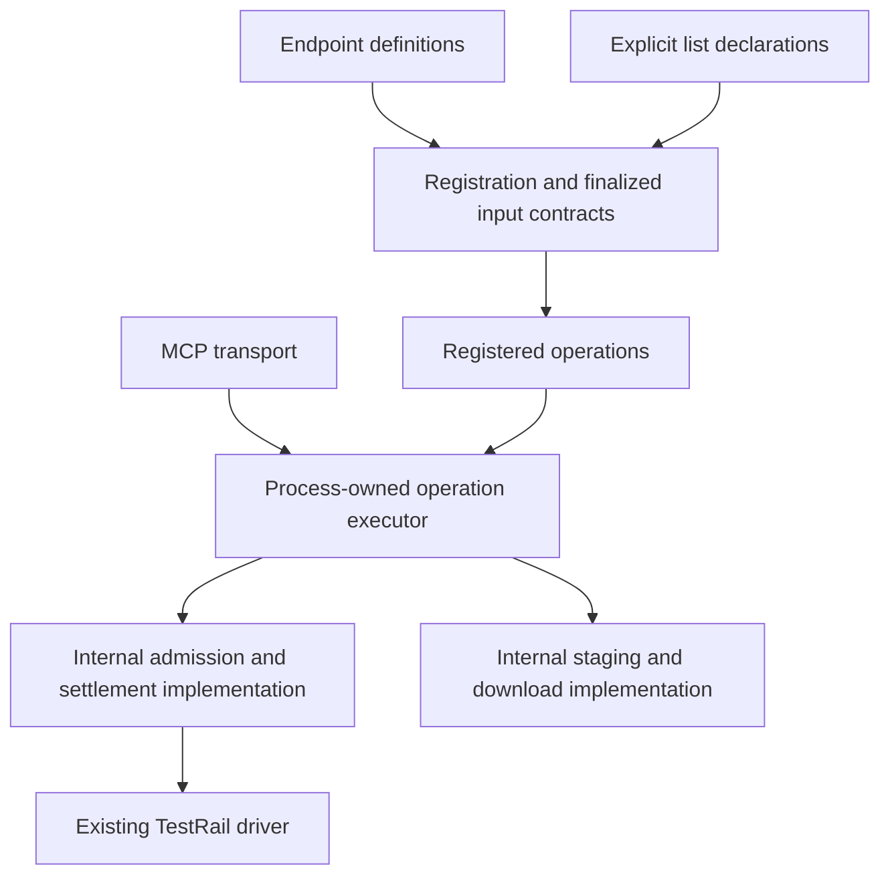

# Architecture refactoring plan

Status: finalized input contracts and list definitions are implemented. The operation executor is implemented and locally verified on 2026-11-21. Both fresh independent reviews are complete. The test-review finding was fixed and rechecked. This plan covers the three deepening opportunities selected during the architecture review. It supplements the existing [implementation plan](implementation-plan.md) without changing the published endpoint contract.

## Accepted decisions

| Module | Decision | Record |
| --- | --- | --- |
| Input contract | Registration finalizes the input contract. The published JSON Schema governs runtime validation. Zod remains the authoring and type-inference tool. | [ADR 0002](adr/0002-json-schema-input-validation.md) |
| List definition | Explicit filter declarations generate both runtime projection and production argument mappings. Independent fixtures retain their own expectations. | [ADR 0003](adr/0003-list-filter-declarations.md) |
| Operation executor | One process-owned module executes ordinary calls and Attachment transfers and owns their runtime and staging lifetimes. | [ADR 0004](adr/0004-operation-executor-lifetime.md) |

The 133 endpoint tools, names, descriptions, schemas, annotations, driver bindings, and result/error contracts remain compatible with [ADR 0001](adr/0001-endpoint-tools.md). Controlled and response-driven lists keep their existing differences. Test Cases, Tests, Test Runs, Test Results, Attachments, and Custom Fields retain the meanings in [CONTEXT.md](../CONTEXT.md).

## Target ownership

Registration owns the input and binding interface. List definitions own shared paging rules. The executor owns when admitted work starts, stops producing a response, and finally releases its resources. Filesystem algorithms and capacity accounting can remain separate implementation modules. Moving code without removing caller obligations does not complete this refactor.

### Finalized input contract

Implemented in `src/contracts/input-contract.ts` with registration-owned typed bindings. The 2026-11-17 verification passed `npm run check` and `npm run test:coverage` on Node 24. 7,030 tests passed, one platform-specific test skipped, and all coverage thresholds exceeded 99%. A captured catalog comparison confirmed identical schemas, descriptions, annotations, routes, bindings and argument maps for all 133 tools. Independent review found and verified fixes for omitted authoring checks, mutable review metadata, and inherited-property validation. Its 2,041 malformed direct-call probes performed no driver lookup.

Start with `src/contracts/inputs.ts`, `src/operations/driver-call.ts`, `src/operations/registry.ts`, and their consumers in transport and contract tests.

- Endpoint authors compose schemas with the existing supported Zod constructs before registration. Registration captures an owned JSON Schema document. Registration audits unsupported transforms/refinements and structural metadata, checks input layout, and compiles validation once per finalized contract.
- The registered operation and its driver bindings share that contract. Runtime callers use its validation interface rather than calling a raw Zod parser. Registration supplies typed binding construction so authors do not repeatedly pass the input schema to each binding.
- The compiled validator must not coerce values, insert defaults, remove properties, or mutate the original input. Successful validation returns the original value, including flat Custom Fields and permitted own `__proto__` properties.
- Keep the input domain JSON. Direct in-process calls must reject non-JSON values without serializing them into different values. Include functions, `undefined`, non-finite numbers, bigint, symbols, cycles, sparse arrays, and non-JSON objects in these tests. This check belongs inside the input contract.
- Unsupported definitions fail during registration. Invalid caller input yields the existing `INVALID_ARGUMENT` result before admission, staging, or driver lookup. Standalone registered binding invocation, used by independent fixtures, also validates before selecting the driver method.
- Early execution validation and a binding's direct-call guard may both run. Do not cache acceptance of a mutable input by object identity or introduce accepted-input tokens merely to remove the second check.
- Retain `DriverMethod<B>` overload checking. Published schemas must be the exact finalized documents used for runtime validation and discovery. Later composition of an authoring schema must not change an already registered operation.
- Keep SDK input advertisement pass-through, so execution produces `INVALID_ARGUMENT` rather than an SDK protocol error. Preserve draft-07 recursive references, reviewed Test Result content constraints, deletion input constraints, and Custom Field property-name policies.

Remove parser-instance patches for original-key handling once the finalized contract covers their behavior. Keep schema adaptation and representability checks that are still needed. Registration and driver calls must no longer independently regenerate competing input contracts.

Migrate schema-identity checks to finalized-contract identity. Update parameter audits, `InputPaths` consumers, schema-emission mocks, and regression helpers together. Tests that expect `ZodError` from direct invocation should assert the input contract's error instead. Comparing two uses of the same compiled validator does not replace independent expected outcomes.

### List definitions

Implemented in `src/operations/lists.ts` on 2026-11-18 for all 24 page/all pairs: 18 controlled and six response-driven. Explicit declarations own schema fields, filter projection and argument mappings. Registration retains typed callbacks with explicit paths and driver methods. The module also prepares calls before admission, enforces configured bounds on standalone aggregate bindings, and interprets replies after acknowledgement.

The unchanged-main baseline passed 7,040 tests. The completed change passed `npm run check` and `npm run test:coverage` on Node 24 with 7,162 tests and all coverage thresholds above 99%. Exact catalog comparison preserved all 133 tools' schemas and metadata. Independent review compared accepted and rejected calls and response cases against main. It also checked every list's configured bounds before admission and direct driver lookup.

The implementation spans `src/operations/families/common.ts`, the list portion of `src/contracts/inputs.ts`, `src/contracts/pagination.ts`, the family declarations, and preparation before admission in `src/execution/executor.ts`.

- Use a registration-owned list definition for the 24 existing page/all pairs. Each filter explicitly declares its input schema, driver property, and serialization (`query-scalar`, `query-list`, or `query-repeated`). Derive production projection and argument mappings from those declarations. Do not infer names through case conversion.
- Path arguments and driver bindings stay explicit. Preserve their order and the actual overloaded method types. Prefer the existing common path-plus-options layout without expanding the module into an arbitrary request dispatcher.
- The list module builds the existing input alternatives and selects page or all mode. It projects supplied filters and supplies effective defaults. It rejects aggregate bounds above configured limits before admission. Refuse excess bounds rather than clamping them.
- The 18 controlled lists retain page defaults of 50 items and offset zero, plus their supported aggregate controls. The six response-driven lists expose no manual page controls or aggregate start offset/page size. Keep the current distinction between advertised schema ceilings and configured execution limits.
- Original input values remain unchanged. Omitted filters stay omitted. Array filters and repeated-reference parameters retain their current serialization.
- Preserve supplied false, zero, and empty-string values, scalar-or-array ID filters, and the Test Result creation filters available only for Test Runs. Attachment lists without page/all helpers retain their single-call behavior and any supported limit/offset parameters. Configured bounds must also be enforced when a registered list binding is invoked directly with its limits.
- Keep page and aggregate response interpretation together with paging behavior. Response interpretation includes outer structure checks, item extraction, continuation disclosure, and aggregate metadata. The driver remains responsible for fetching pages and enforcing aggregation. Introduce no second pagination loop, retry layer, or cache.

Independently authored parameter manifests, expected driver arguments, and expected wire requests remain literal. They must not import production filter declarations or generate expectations from them.

### Operation executor

Implemented in `src/execution/executor.ts` and locally verified on 2026-11-21. `createOperationExecutor(configuration, driver?)` recovers abandoned staging and constructs the configured driver once. Internal assembly owns one runtime and lazily creates one shared staging area, retrying creation after failure. `src/runtime/invocation.ts` and `src/files/` retain the admission, settlement and filesystem algorithms behind that owner. The former transport call pipeline has been removed.

The caller-facing shape is a process-owned executor with `execute(operation, input, options)` and `shutdown()`. Execution options carry the caller's cancellation signal and the negotiated protocol fields needed for accurate result-byte accounting. The executor receives immutable configuration and owns the shared driver/runtime lifetime. `buildServer({ executor, registry })` reuses the executor for individual protocol instances. Internal assembly exposes driver, timing and staging seams for tests without adding lifetime obligations to transport callers.

Local verification on 2026-11-21 used Node 24.22.2. `npm run check` passed with 66 test files, 7,174 passing tests and one platform-specific skip. Package verification checked 81 files and all three protocol modes, each exposing 133 tools. `npm run test:coverage` passed with 99.94% statements, 99.71% branches, 100% functions and 100% lines. Exact comparisons against the pre-refactor baseline preserved catalog metadata and all 133 discovery tool definitions in both protocol eras.

Fresh independent checks killed seven distinct mutations:

| Mutation | Failing tests |
| --- | ---: |
| Remove the failure barrier around internal runtime shutdown | 2 |
| Give staging disposal a fresh drain budget instead of the remaining time | 4 |
| Break the executor's shared-shutdown latch | 1 |
| Remove the cancellation check after the staged copy finishes | 2 |
| Let a late download reply write after abandonment | 1 |
| Acknowledge a soft-delete preview before checking for a named counter | 5 |
| Remove per-copy settlement cleanup | 73 (3 T03 and 70 T12 family cases) |

Both fresh independent reviews are complete. The production review found no issues and confirmed that the normalized execution pipeline was byte-identical to the original. The test review found that shutdown's directory removal had weakened family-level checks for per-copy cleanup. Those checks now wait for zero active slots. They also require the staging directory to contain only `owner.json` before shutdown. They retain the post-shutdown `ENOENT` assertion.

An independent baseline run passed all 240 targeted cases. Removing per-copy settlement cleanup then failed 73 cases (3 T03 and 70 T12). That result closes the test-review finding.

The full check passed again after the final assertion strengthening. The result was 66 test files, 7,174 passing tests and one platform-specific skip. It also included package verification of 81 files and 133 tools in all three protocol modes. The coverage figures above apply to the unchanged production implementation.

`tests/executor-lifetime.test.ts` directly verifies one shared shutdown promise, admission stopped before settlement, one drain and one driver destruction. The composition and staging suites verify the same lifetime through transport, including cleanup after destruction throws and late failures after the drain deadline.

- Input validation and configured list-bound checks precede admission. The executor then chooses the prepared registered call and performs ordinary or file execution under the same admission rules.
- Staging begins only after admission, inside the tracked invocation and response watchdog. A refused call creates no staged copy. Cancellation or response-wait expiry stops copying and prevents a finished copy from being dispatched later.
- Pass the abandonment signal into copying. Check it again after the copy finishes, because the response wait may end while its final close is pending. Keep that final check and dispatch observation synchronous.
- Record dispatch immediately before invoking the driver. Stop further adapter work and snapshot outcome facts before reporting failure, so late completion cannot change an already reported `not_started` or `unknown` outcome.
- Capacity follows the driver's settlement handle and adapter cleanup, not just the result promise. Ordinary per-copy disposal retains the copy until settlement and then empties/removes it. Late failures remain observed.
- Subscribe to the driver result immediately after starting the tracked operation. No asynchronous preparation or logging may intervene before its rejection is observed. Cleanup faults, including synchronous throws, must still release capacity. Count one slot per invocation even when the driver coalesces requests.
- Download writing stays inside the tracked invocation and its binary slot. A reply arriving after abandonment starts no new write. A write already started may complete. Completed files persist even if response delivery later fails.
- Keep acknowledgement ordering. A requested soft-delete preview must carry at least one named counter with a non-null value before acknowledgement. Preserve the current distinction between a missing counter and a counter of an unexpected type. A counter of an unexpected type is advisory drift, not a reason to report an unknown outcome. Ordinary outer-response checks, drift warnings, and output-budget failures occur after the driver's successful result has been acknowledged. Preserve sanitized errors and truthful write outcomes.
- The executor owns lazy staging creation, shared creation, retries after creation failure, and abandoned-staging recovery. Its shutdown is shared and idempotent. Shutdown stops admission, drains, destroys the driver once, and gives staging disposal only the remaining drain budget. Late creation and disposal remain observed.
- Shutdown must resolve even when driver destruction or staging disposal fails. Moving ownership must retain the failure barrier currently around `runtime.shutdown()`. A throwing `driver.destroy()` must not skip disposal of an initialized staging area, prevent the stopped diagnostic, or bypass transport's exit sequence. Disposal still uses only the remaining drain budget.
- Preserve the existing shutdown exception. After the bounded drain, the staging directory may be removed while work remains. Directory removal must not truncate a copy still being read. Completed downloads are never part of staging cleanup or recovery.
- Transport retains protocol registration, cancellation delivery, its defensive handler-failure guard, protocol close, signal handling, stdout flushing, and process exit. It closes protocol intake before executor shutdown. It no longer passes staging directories, binary-slot instructions, or cleanup callbacks into each call.
- Preserve cancellation propagation from protocol closure before draining, so a late download reply cannot begin writing. Include negotiated protocol fields when measuring complete results and the separate error budget. Retain the transport fallback for an unexpected executor rejection.

Retain small internal seams for the real driver, timing tests, and filesystem fault tests. Do not introduce middleware, generic resource hooks, or new network adapters merely to relocate the current sequence.

## Migration sequence

1. **Establish the pinned baseline.** Align the installed dependencies with the lockfile. Run the affected suites before changing runtime code. Record any remaining baseline failures independently. Capture the registered catalog so schema, annotation, description, and binding changes are detectable.
2. **Finalize input validation.** Introduce the shared compiled contract and registration-owned bindings. Migrate operation definitions and direct-call test helpers. Replace raw runtime Zod validation and remove obsolete parser patches only after equivalent behavior is covered through the new interface.
3. **Concentrate list behavior.** Migrate one filtered controlled list and one response-driven list first. Verify their unchanged schemas and independent request fixtures. Then migrate all 24 lists and remove the replaced control-extraction/projection helpers.
4. **Concentrate execution ownership.** Introduce the process executor. Move the runtime and staging session behind it. Route ordinary and Attachment operations through it. Preserve the failure-observation and shutdown ordering above. Replace transport's per-call lifetime assembly with delegation.
5. **Finish verification and documentation.** Run the full repository checks and coverage gate. Review catalog differences. Update the current implementation guides to match the new ownership. Mark the ADRs implemented only when the changes and checks are complete.

These steps can be separate reviewable changes. Migrate the tests that use each replaced interface with that step. Do not keep permanent compatibility paths that still expose the old lifetime obligations.

## Verification

The interface is the test surface. Replace obsolete helper-wiring tests once their behavior is covered through the new module. Retain independent behavioral, filesystem, driver, protocol, and packaging checks.

| Area | Required evidence |
| --- | --- |
| Inputs | Independent accepted/rejected fixtures for every operation; safe schema composition and annotations; described/cloned schemas with own `__proto__` keys; Custom Field preservation; non-JSON direct-call rejection; no mutation/coercion/defaults; invalid inputs cause no driver or file work; overload type checks. |
| Catalog | All 133 endpoint names, schemas, descriptions, annotations, routes, and driver bindings remain compatible. Discovery still makes no TestRail request. |
| Lists | All 24 page/all paths preserve filters and mappings. Configured ceilings are enforced. Defaults, response-driven restrictions, continuation disclosure, malformed responses, and bounded aggregation retain their behavior. |
| Execution | Ordinary writes, soft-delete previews, failures after acknowledgement, serialized result budgets, and cancellation retain their existing outcomes. |
| Attachment lifetime | Busy admission performs no staging. Watchdog/cancellation during copying and final close prevent dispatch. Settlement retains capacity and staged files. Binary capacity covers disk writing. Late replies create no file. Completed files survive failure, shutdown, and restart. |
| Process lifetime | Multiple protocol consumers share the driver and capacity. Concurrent shutdown shares one drain. Stalled staging creation/disposal cannot extend it. Cleanup failures remain observed. Packaged stdin/signal shutdown and stdout flush behavior remain intact. Add a combined regression with an initialized staging area and a throwing `driver.destroy()`. Disposal is still attempted. Shutdown resolves within the remaining budget. The stopped diagnostic is emitted. |

Relevant existing suites include these files:

- `tests/inputs.test.ts`
- `tests/registered-parameters.test.ts`
- `tests/paging-through-tools.test.ts`
- `tests/result-contract.test.ts`
- `tests/soft-delete-preview.test.ts`
- `tests/runtime-*.test.ts`
- the lifetime, composition, cancellation, and result-budget tests under `tests/transport/`

Run `npm run check` and `npm run test:coverage` for the completed refactor, including the existing 99% coverage thresholds. Fixtures require no live TestRail credentials.

## Review-time verification limitation (resolved)

Before implementation, `npm ci` restored the pinned dependency set and the unchanged baseline passed `npm run check` with 6,988 tests. The completed input refactor passed the checks recorded above in a clean copy of the changes, excluding unrelated local worktrees. The following records the original review limitation, not the current verification state.

The installed dependencies did not match the manifest and lockfile during this review:

| Package | Installed | Declared and locked |
| --- | --- | --- |
| `@dichovsky/testrail-api-client` | 7.2.0 | 9.0.0 |
| `@modelcontextprotocol/server` | 2.0.0 | 2.4.0 |
| `zod` | 4.6.1 | 4.6.7 |
| `vitest` | 4.1.11 | 5.1.0 |

`npm test -- tests/registered-parameters.test.ts tests/inputs.test.ts` produced 54 passing and seven failing input tests. The registered-parameter suite failed during import. The cloning discrepancy was reproduced against that installed dependency set. Those observations alone did not establish a passing pinned baseline or completed implementation. The later verification above supersedes that limitation.
